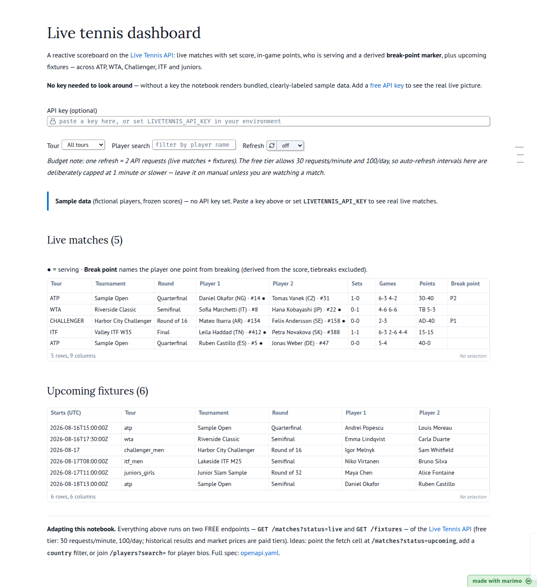

# Live tennis dashboard (marimo)

[](https://marimo.app/github.com/livetennisapi/livetennis-marimo/blob/main/live_tennis_dashboard.py)

A reactive [marimo](https://github.com/marimo-team/marimo) notebook on the
[Live Tennis API](https://livetennisapi.com): live matches with set score,
in-game points, who is serving and a derived **break-point marker**, plus
upcoming fixtures — across ATP, WTA, Challenger, ITF and juniors. A tour
dropdown and a player-search box filter both tables reactively.

**It renders without an API key**: with no key the notebook shows bundled,
clearly-labeled sample data ([`sample_data.json`](sample_data.json), fictional
players), so you can explore the whole flow before signing up.



## Running this notebook

The notebook's dependencies are serialized in its header as inline script
metadata, so the easiest way to run it is in a sandbox:

1. [Install `uv`](https://github.com/astral-sh/uv/?tab=readme-ov-file#installation)
2. Run:

   ```bash
   uvx marimo edit --sandbox https://github.com/livetennisapi/livetennis-marimo/blob/main/live_tennis_dashboard.py
   ```

> [!TIP]
> The [`--sandbox` flag](https://docs.marimo.io/guides/package_reproducibility/)
> opens the notebook in an isolated virtual environment, automatically
> installing its dependencies.

You can also clone the repo (which brings `sample_data.json` along) and run
`marimo edit --sandbox live_tennis_dashboard.py`, or open it without `uv`
after [installing marimo](https://docs.marimo.io/getting_started/index.html#installation)
and `requests` yourself.

## Using live data

1. Get a key — the [free tier](https://livetennisapi.com/subscribe/free) is
   self-serve, no card.
2. Either set it in your environment before starting marimo:

   ```bash
   export LIVETENNIS_API_KEY=ltapi_...
   ```

   or paste it into the API-key field at the top of the notebook.

The notebook uses two FREE endpoints: `GET /matches?status=live` and
`GET /fixtures`. Free-tier limits are **30 requests/minute and 100/day**
(historical results, market prices and model fields are paid tiers), so the
notebook never auto-polls: refresh is manual by default, and the optional
auto-refresh intervals are capped at 1 minute or slower. One refresh costs 2
requests.

## Adapting the notebook

- **Other match states**: point the fetch cell at `/matches?status=upcoming`
  (FREE). `status=completed` needs a paid (BASIC+) key.
- **More filters**: `/matches` also accepts `player`, `country` and
  `from`/`to` query params.
- **Player bios**: join `/players?search=` (FREE) on the names in the tables.
- Full API reference: [docs.livetennisapi.com](https://docs.livetennisapi.com)
  ([openapi.yaml](https://docs.livetennisapi.com/openapi.yaml)).

The break-point column is derived client-side (receiver at AD, or at 40 while
the server is below 40; tiebreaks excluded) — the API sends `points` and
`server`, not a break-point flag. The logic lives in the `break_point`
function if you want to extend it (e.g. set points).

## Verification

`assets/preview.html` is the output of a headless
`marimo export html live_tennis_dashboard.py` run with no API key — the exact
sample-data rendering shown in the screenshot. CI repeats that export on every
push.

## License

[MIT](LICENSE)
